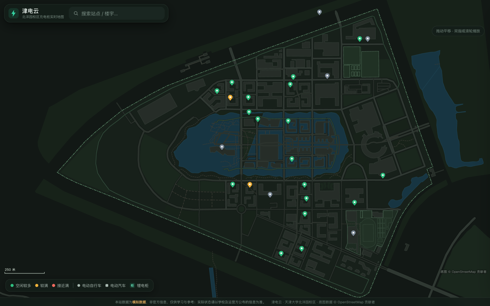
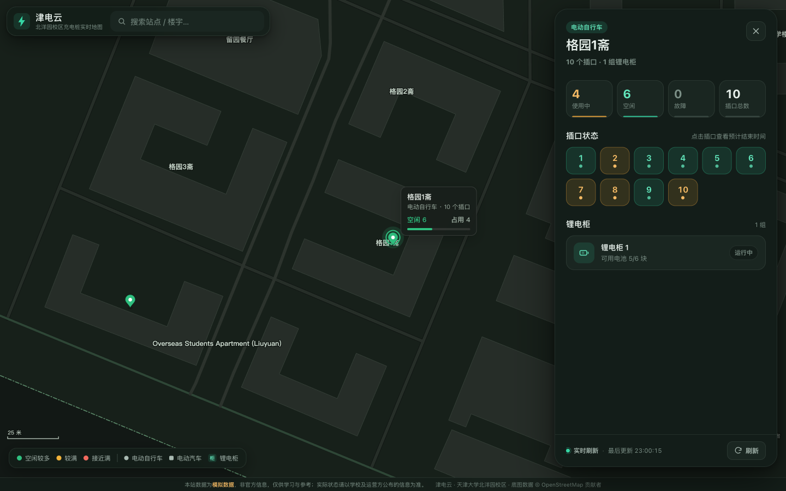
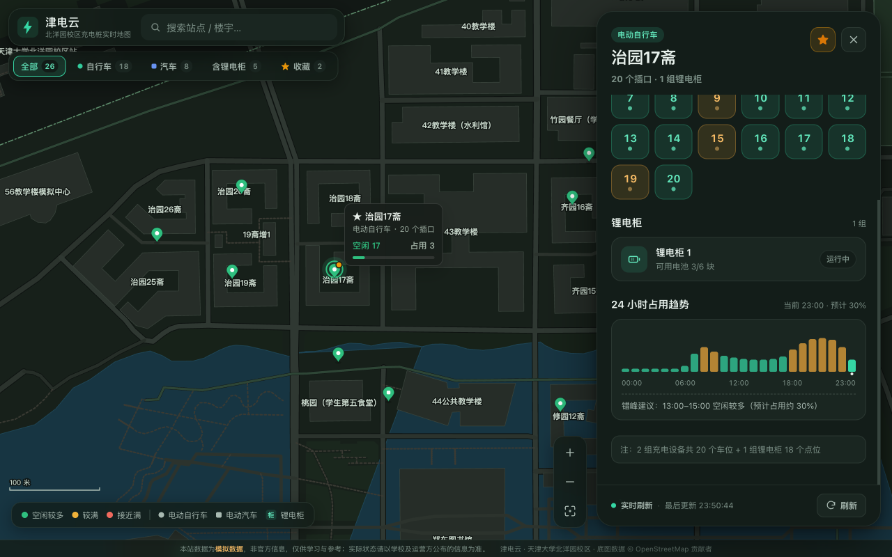
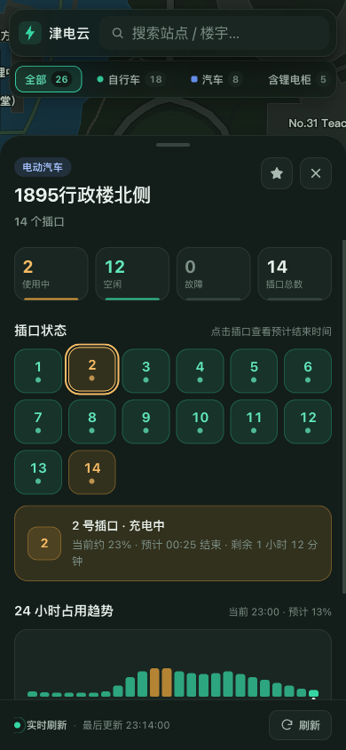
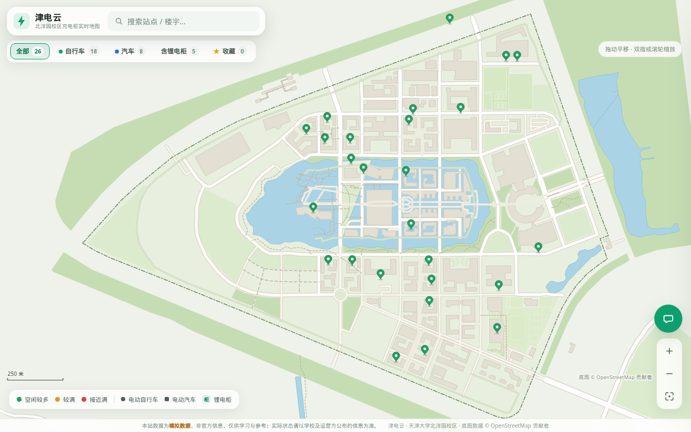
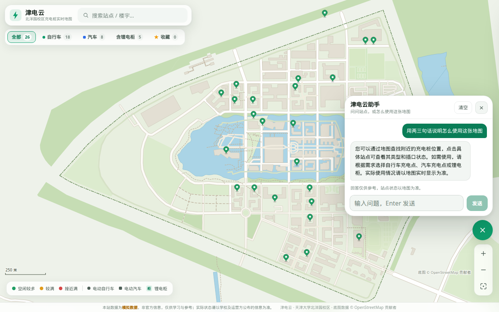
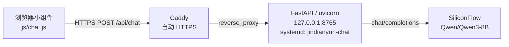

# 津电云

> 天津大学北洋园校区电动车充电桩实时状态地图

津电云是一个面向天津大学北洋园校区的充电桩状态地图：在离线矢量校园底图上查看电动自行车与电动汽车充电点的位置、插口占用情况与预计结束时间，帮助师生少走空路、错峰充电。地图加载完成后，桌面端右侧、窄屏左侧会出现悬浮问答按钮，用来询问站点概况和地图用法。

> **数据声明**
>
> 本站当前展示的是**模拟数据**，与天津大学及任何充电运营方均无隶属关系；点位信息整理自 OpenStreetMap 等公开资料，**并非官方数据**，可能存在偏差。实际充电状态请以学校及运营方公布的信息为准。

## 界面预览





| 深色模式 | 移动端 |
| --- | --- |
|  |  |

### 问答助手





按钮在地图就绪后出现。点开可以提问；回答只供参考，插口是否空闲以地图上的颜色和站点详情为准。

## 功能特性

- **离线矢量底图** — 基于 OpenStreetMap 数据自绘北洋园校区（112 个建筑轮廓、95 栋命名建筑、276 段道路、87 个绿地/水域、32 个运动场地），不依赖在线瓦片、地图 Key 或外部 CDN。
- **充电点状态（模拟 / 可插拔）** — 26 个充电站点：18 个电动自行车站点（229 个插口、8 组锂电柜）与 8 个电动汽车站点（61 个车位，含 2 处实测 + 6 处预估）；展示使用中 / 空闲 / 故障数量与逐插口状态，占用插口显示预计结束时间、倒计时与估算电量（SOC）。
- **分类筛选与常用收藏** — 顶部胶囊筛选栏支持按「全部 / 自行车 / 汽车 / 含锂电柜 / ★ 收藏」一键过滤地图图钉；支持将常用宿舍或教学楼站点加入本地收藏（`localStorage`），地图图钉右上角带星标高亮，搜索框聚焦时置顶展示。
- **24 小时占用趋势与错峰建议** — 站点详情面板内置 24 小时预计占用率柱状图，高亮当前时段并自动计算日间空闲较多的建议错峰充电时段。
- **站点与楼宇检索** — 搜索框既可搜充电站点，也可搜楼宇（38/39 教、工会、郑东图书馆等），选中后地图直接定位，全程键盘可操作。
- **地图缩放与复位控件** — 支持拖拽平移、滚轮/双指缩放、双击放大，以及右下角悬浮放大 / 缩小 / 一键复位全校区视野控件。
- **问答助手** — 悬浮按钮打开对话面板，可询问站点概况或地图用法。浏览器把最近对话和当前已加载站点的名称、空闲 / 占用 / 故障数量发到 `js/chat.js` 里的 `CHAT_API_URL`；回复按纯文本渲染（换行、`**加粗**`、行内代码）。对话只留在当前标签页的 `sessionStorage`。密钥在服务器上的文件里。架构与限额见下文。
- **深浅色主题** — 跟随系统 `prefers-color-scheme`，颜色统一由 CSS 自定义属性驱动。
- **零构建的静态地图** — 页面是纯 HTML + 原生 ES Modules + Canvas 2D，无 npm、无打包器、无框架，静态托管即可运行。问答请求发到单独的 HTTPS 接口；接口暂时不可用时，地图照常使用。
- **可插拔数据源与本地代理脚手架** — 自带模拟适配器（`js/mock-adapter.js`）、HTTP 实时适配器（`js/http-adapter.js`）以及常青藤智能充电本地代理脚本（`scripts/cqt_proxy.mjs`），见 [适配器开发指南](docs/adapter-guide.md)；真实数据从哪来见 [真实数据获取路线](docs/real-data.md)。
- **无障碍与移动端优化** — 语义化结构、键盘操作、`focus-visible`、安全区适配、按 `devicePixelRatio` 清晰渲染。

## 快速开始

本站不需要安装任何依赖，也不需要构建。由于浏览器对 ES Modules 与 `fetch()` 的限制，**请通过静态服务器打开**；直接双击 `index.html`（`file://` 协议）会因跨域限制而加载失败。

```bash
cd 津电云      # 或你的项目目录
python3 -m http.server 8000
```

然后访问 <http://localhost:8000>。

本地页面可以打开助手面板。生产接口的 CORS 只允许 `https://xiaomeng0831.github.io`，所以在 localhost 里提问会看到「助手服务暂时连不上，请稍后再试。地图仍可正常使用。」地图数据不走这个接口。

可选冒烟测试（不参与 GitHub Pages 部署，站点运行时仍然零依赖）：

```bash
npm install
npx playwright install chromium
npm run test:e2e
```

`tests/smoke.spec.js` 会打开页面、搜索「格园」并确认站点面板打开。`tests/chat.spec.js` 会拦截 `CHAT_API_URL` 检查问答面板，不会访问线上接口。

其他等价方式（任选其一）：

```bash
npx serve .          # Node.js 环境
php -S localhost:8000
```

浏览器要求：支持 ES Modules、Canvas 2D、`fetch` 与 CSS 自定义属性的现代浏览器（Chrome / Edge / Firefox / Safari 近两年版本均可）。

## 部署到 GitHub Pages

本项目是纯静态站点，**无需构建**，可直接部署到 GitHub Pages。

1. 在 GitHub 新建仓库（例如 `jindianyun`），将代码推送到 `main` 分支：

   ```bash
   cd 津电云
   git init
   git add .
   git commit -m "feat: 津电云静态站点"
   git branch -M main
   git remote add origin https://github.com/<你的用户名>/<仓库名>.git
   git push -u origin main
   ```

2. 打开仓库的 **Settings → Pages**；
3. **Build and deployment → Source** 选择 **Deploy from a branch**；
4. **Branch** 选择 `main`，目录选择 `/ (root)`，点击 **Save**；
5. 等待 1–2 分钟，访问 `https://<你的用户名>.github.io/<仓库名>/`。

之后每次推送到 `main`，GitHub Pages 会自动重新发布。

补充说明：

- 站内资源全部使用相对路径，部署在 `/<仓库名>/` 子路径下无需修改配置；
- 无需 GitHub Actions 或任何构建配置；
- 如需绑定自定义域名，可在 **Settings → Pages → Custom domain** 中设置；
- 若后续添加以 `_` 开头的文件或目录，请在根目录放一个空的 `.nojekyll` 文件以跳过 Jekyll 处理。

## 架构概览

### 零构建静态站

`index.html` 通过 `<script type="module" src="js/app.js">` 直接加载源码，浏览器原生解析 ES Modules；没有 npm、打包器或 TypeScript。所有样式与脚本均自包含，不引用任何 CDN。

### 分层与模块

```text
index.html + css/                页面结构与主题
└── js/app.js                    应用入口与状态编排
    ├── js/map.js                地图交互（平移 / 缩放 / 选点）
    ├── js/basemap.js            离线矢量底图渲染（Canvas）
    ├── js/panel.js              站点详情面板
    ├── js/chat.js               悬浮问答助手（CHAT_API_URL）
    └── js/format.js             中文格式化工具

数据适配器（默认 js/mock-adapter.js）
└── getStationDetail(id) / subscribe / refresh

data/basemap.json                OSM 矢量底图
data/stations.json               26 个站点静态信息
```

### 适配器模式

运行时的“插口占用状态”与“站点静态信息”分离：

- `data/stations.json` 只保存站点静态资料（名称、类型、插口数、经纬度等）；
- 适配器负责产出每个站点的实时 `detail`（插口状态、预计结束时间、锂电柜状态）；应用再据此计算地图着色所需的占用字段；
- 默认的模拟适配器按时间演化数据，使界面在没有真实接口时也能完整体验；
- 替换适配器即可接入真实数据源，地图渲染与详情面板无需改动。

完整的接口契约、示例代码与合规注意事项见 [docs/adapter-guide.md](docs/adapter-guide.md)。

### 问答助手后端

地图页面仍由 GitHub Pages 发布。悬浮按钮里的脚本把对话发到单独的后端，密钥留在那台小型 Linux 虚拟机上：



`CHAT_API_URL` 写在 `js/chat.js`。文档和 Caddy 示例里的对外主机名用占位符 `chat.example.com`，安装时再换成真实主机名。Caddy 用 Let's Encrypt 为该主机名申请证书，再反代到本机 `127.0.0.1:8765`。Caddy 前面还有 Fastly；访问日志里像 `140.248.50.x` 这样的地址是 Caddy 看到的访客地址，不是本机反代。进程由 systemd 服务 `jindianyun-chat.service` 启动。模型默认是 SiliconFlow 免费额度上的 `Qwen/Qwen3-8B`。

| 限制 | 行为 |
| --- | --- |
| 频率 | 每个访客 IP 每分钟 10 次、每天 100 次。超出返回 429、一句中文说明和 `Retry-After`。地址只在直连对端是 `127.0.0.1` / `::1` 时从 `X-Forwarded-For` 的最右侧非本机地址读取，不用最左侧（访客可伪造）。详见 [server/README.md](server/README.md) |
| 全站 | 每天最多 1000 次上游模型调用（`CHAT_GLOBAL_DAILY_CAP`），超出同样是 429。这是费用保护 |
| 对话 | 浏览器提交最近 12 轮（最多 24 条 user / assistant 消息）。服务端只把其中最后 12 条发给模型 |
| 单条输入 | 浏览器输入框最多 800 字 |
| 字数 | 服务端发给模型的这 12 条正文合计不超过 4000 字；单条最长 2000 字；站点摘要 `context` 最长 2000 字 |
| 范围 | 只回答北洋园校区充电桩地图和津电云用法。编程、写作等无关请求由系统提示要求礼貌拒绝。回复若复述系统提示，服务端会整段换成拒绝 |
| 来源 | CORS 只允许 `https://xiaomeng0831.github.io` |
| 密钥 | 只放在服务器文件 `~/.sf_key`（可用环境变量 `SILICONFLOW_KEY_FILE` 改路径），权限 `600`。仓库的 `.gitignore` 会挡住同名文件 |

参考实现、systemd 单元、Caddy 示例和部署步骤在 [server/README.md](server/README.md)。示例里的域名和证书邮箱是占位符。问答接口不提供充电桩实时状态；插口占用仍来自页面上的模拟数据或另行接入的适配器。

### 目录结构

```text
.
├── index.html               单页入口
├── 404.html                 GitHub Pages 404 页面
├── .env.example             常青藤本地代理环境变量模板
├── css/                     样式（CSS 自定义属性 + 深浅色主题）
├── js/                      零构建 ES Modules
│   ├── app.js               应用入口、搜索、分类筛选与收藏编排
│   ├── basemap.js           离线矢量底图渲染
│   ├── map.js               地图交互、视野控件与站点图钉
│   ├── panel.js             站点详情面板（含 24h 占用趋势图）
│   ├── chat.js              悬浮问答助手（CHAT_API_URL、最近 12 轮）
│   ├── format.js            中文格式化工具
│   ├── adapter.js           数据适配器契约与校验工具
│   ├── mock-adapter.js      默认模拟数据适配器（含作息曲线）
│   └── http-adapter.js      HTTP 实时数据适配器（含退避与混合回退）
├── data/
│   ├── basemap.json         OSM 提取的校园矢量底图（112 建筑 / 276 道路）
│   └── stations.json        26 个充电站点静态信息（18 自行车 + 8 汽车）
├── docs/
│   ├── adapter-guide.md     数据源适配器开发指南
│   ├── real-data.md         真实数据获取路线（常青藤接口 / 优易充 / 北洋维基）
│   └── screenshots/         桌面端、移动端与问答助手预览图
├── server/                  问答后端参考实现（Pages 不运行，不含密钥）
│   ├── README.md            虚拟环境、密钥文件、systemd、Caddy、curl、轮换与日志
│   ├── app.py               FastAPI 应用（访客 IP 限流、全站上限、提示词过滤）
│   ├── requirements.txt     线上使用的 Python 依赖版本
│   ├── requirements-dev.txt 离线 pytest，不装进线上环境
│   ├── tests/               不访问网络的后端测试
│   ├── jindianyun-chat.service
│   └── Caddyfile.example    域名与 ACME 邮箱为占位符
└── scripts/                 数据构建与本地代理脚本
    ├── build_basemap.js     从 OSM 原始数据构建 data/basemap.json
    ├── build_stations.js    按命名建筑生成 data/stations.json
    └── cqt_proxy.mjs        常青藤智能充电本地缓存代理服务（Node 18+）
```

## 数据说明

| 数据 | 内容 | 来源 |
| --- | --- | --- |
| `data/basemap.json` | 校园边界、112 个建筑轮廓（95 个有名称）、276 段道路、87 个绿地 / 水域、32 个运动场地 | 从 OpenStreetMap 提取（脚本见 `scripts/`） |
| `data/stations.json` | 26 个充电站点：18 个电动自行车站点（229 个插口、8 组锂电柜）与 8 个电动汽车站点（61 个车位，其中 2 处 21 口来自北洋维基、6 处 40 口为预估） | 按[北洋维基](https://wiki.tjubot.cn/campus-infrastructure/charging-pile)整理；预估车位标注 `socketsApprox: true` |
| 插口实时状态 | 使用中 / 空闲 / 故障、预计结束时间、24h 占用趋势 | 默认由 `js/mock-adapter.js` 模拟生成；支持通过 `?adapter=http` 切换至 `js/http-adapter.js` |

**免责声明**

- 本项目为个人学习性质的非官方项目，不代表天津大学或任何充电运营方；
- 所有实时状态均为模拟数据，**不可用于实际出行决策**；
- 问答助手的回答由模型生成，只供参考，不能当作插口的实时状态；
- 点位信息来自公开资料，部分电动汽车车位数为预估，可能与实际情况存在偏差；
- 底图数据 © OpenStreetMap 贡献者，遵循 [ODbL 许可](https://www.openstreetmap.org/copyright)。

## 接入真实数据源

当前默认使用模拟适配器。若你希望在本地联调或接入「常青藤智能充电」接口，项目已内置完整的 HTTP 适配器与本地代理脚手架：

```bash
# 1. 启动本地代理（未配置 .env 时默认运行在 proxy-mock 联调模式）
node scripts/cqt_proxy.mjs

# 2. 在浏览器中通过 ?adapter=http 启用 HTTP 适配器
open "http://localhost:8000/?adapter=http"
```

如需填入个人抓包获得的 `OPEN_ID`，请复制 `.env.example` 为 `.env` 后配置。步骤、接口契约与合规注意事项见 [docs/adapter-guide.md](docs/adapter-guide.md) 与 [docs/real-data.md](docs/real-data.md)。

> 请勿绕过第三方平台的登录、签名或风控机制抓取数据，也不要将任何密钥写入前端代码或提交到仓库。问答接口的密钥放在服务器的 `~/.sf_key`，说明见 [server/README.md](server/README.md)。

## 路线图

- [x] 离线矢量校园底图（OSM → `data/basemap.json`，112 建筑 / 276 道路）
- [x] 充电站点静态数据（18 个自行车站点 / 229 个插口 / 8 组锂电柜 + 8 个电动汽车站点 / 61 个车位）
- [x] 地图渲染、站点与楼宇检索、详情面板与缩放/复位视野控件
- [x] 站点分类筛选、常用站点收藏（`localStorage`）与 24 小时占用趋势图
- [x] 模拟数据适配器 + HTTP 实时数据适配器（`js/http-adapter.js`）+ 本地代理脚手架（`scripts/cqt_proxy.mjs`）
- [x] 悬浮问答助手（`js/chat.js`）与不含密钥的参考后端（`server/`）
- [ ] 实地核实其余 6 处电动汽车站点的精确快慢充车位数
- [ ] PWA / 离线缓存与主屏图标
- [ ] 多校区支持

## 参与贡献

欢迎提交 Issue 与 Pull Request。完整的开发说明见 [CONTRIBUTING.md](CONTRIBUTING.md)。核心约定：

- **保持零依赖**：页面运行时不要引入 npm 包、框架、CDN 资源或构建步骤（可选的 Playwright 冒烟测试不参与部署）；
- **原生 ES Modules**：新增模块使用 `import` / `export`，保证纯浏览器可直接运行；
- **中文界面**：所有用户可见文案使用简体中文；
- **数据修正**：请附上可核实的来源；不要提交通过非公开接口抓取的个人数据或凭据。问答密钥只放在服务器的 `~/.sf_key`；
- **本地验证**：提交前用 `python3 -m http.server` 打开页面，检查桌面端与移动端、浅色与深色主题；
- **适配器改动**：遵循 [适配器开发指南](docs/adapter-guide.md) 的接口契约。

## 许可证

本项目基于 [MIT License](LICENSE) 开源，Copyright (c) 2026 津电云项目贡献者。