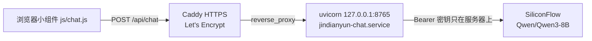

# 津电云问答后端

本目录是线上问答接口的参考实现，给静态页面上的悬浮助手提供 `POST /api/chat`。GitHub Pages 只发布地图页面，不会运行这里的 Python。

`app.py` 与 `requirements.txt` 与当前线上进程一致，仓库里没有 API 密钥。示例里的域名和 ACME 邮箱是占位符（`chat.example.com`、`you@example.com`）。把示例复制到 `/etc/caddy/Caddyfile` 之后再替换，仓库里的示例保持占位符。

调用关系：



页面把请求发到 `js/chat.js` 里的 `CHAT_API_URL`。Caddy 终止 HTTPS，并把该主机名反代到本机 `127.0.0.1:8765`。systemd 服务 `jindianyun-chat.service` 用 uvicorn 跑 FastAPI。上游默认是 SiliconFlow 的 `Qwen/Qwen3-8B`（免费额度）。这套服务跑在一台小型 Linux 虚拟机上。

## 文件

| 文件 | 作用 |
| --- | --- |
| `app.py` | FastAPI 应用。只监听本机，关闭了自带的 `/docs` |
| `requirements.txt` | 线上使用的依赖版本 |
| `requirements-dev.txt` | 只含 pytest，给离线测试用，不要装进线上环境 |
| `tests/` | 不访问网络、不读真实密钥的 pytest |
| `jindianyun-chat.service` | systemd 单元示例。账号和路径是占位符 `your-user`，安装前要改成真实用户 |
| `Caddyfile.example` | Caddy 配置示例。域名和邮箱是占位符 |

应用只提供两个路由：`GET /healthz` 和 `POST /api/chat`。

## 行为与限额

这些数字写在 `app.py` 里，和页面小组件配合使用。

| 项目 | 值 |
| --- | --- |
| 频率 | 每个访客 IP 每分钟 10 次（`CHAT_RATE_PER_MIN`）、每天 100 次（`CHAT_RATE_PER_DAY`）。超出返回 429、一句短中文和 `Retry-After`。计数在进程内存里，重启服务会清零 |
| 全站上限 | 每天最多 1000 次上游模型调用（`CHAT_GLOBAL_DAILY_CAP`）。只计算真正发给模型的请求，用来限制费用。超出同样是 429 |
| 浏览器单条 | 输入框最多 800 字（`index.html` 的 `maxlength` 与 `js/chat.js` 的 `MAX_INPUT_LENGTH`） |
| 浏览器提交 | 最近 12 轮对话（一轮是一条用户消息加一条助手消息，最多 24 条），另加一段站点摘要 |
| 转给模型 | 服务端只把请求里的最后 12 条消息发给模型。浏览器最多会提交 24 条（12 轮） |
| 字数 | 上述 12 条正文合计不超过 4000 字；单条最长 2000 字；可选 `context` 最长 2000 字 |
| 范围 | 系统提示要求只回答北洋园校区充电桩地图和津电云用法。回复里若出现围栏代码（` ``` `）或明显的源码，服务端换成一句中文拒绝，不把代码返回 |
| 提示词 | 回复若复述系统提示里的原句，服务端整段换成一句拒绝，不把原文返回 |
| CORS | 只允许 `https://xiaomeng0831.github.io` |
| 模型 | `Qwen/Qwen3-8B`，可用环境变量 `SILICONFLOW_MODEL` 覆盖 |
| 上游地址 | `https://api.siliconflow.cn/v1`，可用 `SILICONFLOW_API_BASE` 覆盖 |
| 上游超时 | 30 秒。浏览器大约 20 秒后会自己放弃等待 |
| 监听 | `127.0.0.1:8765`，启动命令必须带 `--no-proxy-headers`。uvicorn 0.32 默认会改写转发头，只是不写 `--proxy-headers` 关不掉。见「访客 IP」 |

### 访客 IP

调用链是：访客 → Fastly → Caddy → 本机 `127.0.0.1:8765`。Caddy 把看到的对端地址追加到 `X-Forwarded-For` 的右侧。日志里像 `140.248.50.x` 这样的地址是 Caddy 看到的访客地址（面向访客的边缘地址），不是这台机器上的代理，限流时不能把它当成可信代理跳过。

`get_client_ip`：

- 只有直连对端 `request.client.host` 是 `127.0.0.1` 或 `::1` 时，才读取 `X-Forwarded-For`。
- 从该头最右侧往左看，跳过 `127.0.0.1` 和 `::1`，采用第一个其余地址。这是 Caddy 追加的那一跳。
- 不用最左侧。访客可以自己带一个 `X-Forwarded-For`，Caddy 会把真实对端补在右边；取左边就会按伪造地址分桶，限流可以绕过。
- 对端不是本机时，忽略这个头，直接用对端地址。
- 头为空，或里面没有可用地址时，退回对端地址。

uvicorn 0.32 起默认打开代理头，`forwarded_allow_ips` 默认是 `127.0.0.1`。不写 `--proxy-headers` 也会把 `request.client` 改成转发地址，端口记成 `0`（日志里会看到类似 `10.0.0.9:0`）。改写之后对端不再是本机，`get_client_ip` 就不会读 `X-Forwarded-For`。启动命令必须写上 `--no-proxy-headers`，并只监听 `127.0.0.1`。只是省略 `--proxy-headers` 关不掉这层改写。

成功的响应不带限额头。限流和全站上限才返回 429。

当前没有登录或 Turnstile。如果以后滥用继续增加，可以再在 Caddy 或应用前加 Turnstile；那不是现在这条链路的一部分。

密钥默认从服务用户家目录的 `~/.sf_key` 读取。要换路径，设置环境变量 `SILICONFLOW_KEY_FILE`（在 systemd 单元里加 `Environment=` 即可）。文件内容是一行密钥，权限 `600`，属主是运行服务的用户。

仓库根目录的 `.gitignore` 会忽略名为 `.sf_key`、`sf_key` 或以 `.sf_key` 结尾的文件；`server/.gitignore` 写了同样的名字，这个目录被单独拷走时也有效。密钥放在家目录，不要放进本仓库的工作区。提交前看一下 `git status`，确认没有密钥文件。

## 在虚拟机上部署

单元和下面的命令用占位账号 `your-user`、目录 `/home/your-user`。安装前先把 `jindianyun-chat.service` 里的 `User`、`Group`、`WorkingDirectory`、`ExecStart` 和 `Environment=HOME` 换成运行服务的真实账号和家目录，后文路径跟着改。不要把真实用户名提交回仓库。单元把家目录标成只读，进程需要能读到虚拟环境和密钥文件。

需要 Python 3.11 或更新版本，以及 Caddy 2。Caddy 的安装见 <https://caddyserver.com/docs/install>。

### 1. 虚拟环境与依赖

```bash
sudo apt update
sudo apt install -y python3-venv
sudo install -d -o your-user -g your-user /home/your-user/jindianyun-chat
sudo -u your-user python3 -m venv /home/your-user/jindianyun-chat/.venv
sudo -u your-user /home/your-user/jindianyun-chat/.venv/bin/pip install \
  -r server/requirements.txt
sudo -u your-user cp server/app.py /home/your-user/jindianyun-chat/app.py
```

后两条里的 `server/requirements.txt` 和 `server/app.py` 指本仓库里的文件。在仓库根目录执行，或写成这两个文件的实际路径。

### 2. 写入密钥

用运行服务的那个用户创建文件，并用编辑器把密钥贴进去。不要把密钥写在命令行里，否则它会留在 shell 历史和进程列表中。

```bash
sudo -u your-user install -m 600 /dev/null /home/your-user/.sf_key
# 用编辑器以 your-user 打开 /home/your-user/.sf_key，写入密钥后保存。
sudo -u your-user chmod 600 /home/your-user/.sf_key
sudo -u your-user stat -c '%a %U %n' /home/your-user/.sf_key
```

`stat` 应显示 `600 your-user`。文件里只有密钥本身，不要加引号、不要留 `export`。

### 3. 安装并启动 systemd 单元

```bash
sudo cp server/jindianyun-chat.service /etc/systemd/system/jindianyun-chat.service
sudo systemctl daemon-reload
sudo systemctl enable --now jindianyun-chat.service
systemctl status jindianyun-chat.service
```

启动成功时，日志里有一行以 `chat backend ready, model=Qwen/Qwen3-8B` 开头。密钥文件缺失或为空时进程会退出并按单元里的 `Restart=on-failure` 重试，这时先看日志再查 `~/.sf_key`。

### 4. 配置 Caddy

先把示例装到 Caddy 的配置路径，再在那份副本里把 `you@example.com` 换成接收 Let's Encrypt 通知的邮箱，把 `chat.example.com` 换成对外主机名。这个主机名要和 `js/chat.js` 的 `CHAT_API_URL` 一致，并解析到这台虚拟机；TCP 80 和 443 需要能从公网访问，Caddy 才会自动申请证书。不要把改过邮箱或域名的配置提交回仓库。

```bash
sudo cp server/Caddyfile.example /etc/caddy/Caddyfile
# 编辑 /etc/caddy/Caddyfile，替换占位邮箱和站点名。
sudo caddy validate --config /etc/caddy/Caddyfile
sudo systemctl reload caddy
```

示例文件是一份完整的 Caddyfile：全局邮箱加上这一个站点。把它安装到 `/etc/caddy/Caddyfile` 之后，Caddy 只按这份文件提供问答接口的 HTTPS。

如果 Pages 上的小组件还指向旧主机名，更新 `CHAT_API_URL` 后再发布静态页。CORS 只放行 `https://xiaomeng0831.github.io`，页面需要从该来源打开。

### 5. 用 curl 确认

把 `chat.example.com` 换成上一步的主机名。

```bash
curl -fsS http://127.0.0.1:8765/healthz
curl -fsS https://chat.example.com/healthz
```

两处都应返回 `{"ok":true}`。`/healthz` 只说明进程在听，不会向上游校验密钥。再发一条真实提问：

```bash
curl -fsS https://chat.example.com/api/chat \
  -H 'content-type: application/json' \
  -d '{"messages":[{"role":"user","content":"用一句话介绍津电云"}]}'
```

成功时响应形如 `{"reply":"……"}`。密钥被上游拒绝时，这里会是 HTTP 502，正文里是面向访客的中文说明，而 `/healthz` 仍然返回正常。

CORS 可以用预检看一眼：

```bash
curl -sI -X OPTIONS https://chat.example.com/api/chat \
  -H 'Origin: https://xiaomeng0831.github.io' \
  -H 'Access-Control-Request-Method: POST' \
  -H 'Access-Control-Request-Headers: content-type'
```

响应里应有 `access-control-allow-origin: https://xiaomeng0831.github.io`。curl 本身不带 `Origin` 时不受这条限制；浏览器从其他网站打开页面时会被拦住。本地 `python3 -m http.server` 的来源同样不在允许列表里，所以 localhost 上的小组件提问失败是预期情况，地图页面不受影响。

## 轮换密钥

1. 在 SiliconFlow 控制台准备新密钥，并作废将要停用的旧密钥。
2. 仍用服务用户的编辑器改 `/home/your-user/.sf_key`，保存后执行 `chmod 600`。不要把新密钥写进 shell 命令。
3. 重启进程，让它重新读取文件：

   ```bash
   sudo systemctl restart jindianyun-chat.service
   journalctl -u jindianyun-chat.service -n 30 --no-pager
   ```

4. 确认日志里有 `chat backend ready`，且没有打出密钥。然后按上一节再 `curl` 一次 `/api/chat`。只看 `/healthz` 不够。

## 查看日志

应用的标准输出和标准错误都进 journal：

```bash
journalctl -u jindianyun-chat.service -n 200 --no-pager
journalctl -u jindianyun-chat.service -f
```

Caddy 的证书申请和反代错误：

```bash
journalctl -u caddy.service -n 200 --no-pager
```

问答日志里会有模型名、被限流的 IP，以及上游错误正文的前 300 个字符。密钥不应出现在这些行里。

## 本地只跑应用

不装 systemd 也可以在本机看接口。在仓库的 `server/` 目录：

```bash
python3 -m venv .venv
.venv/bin/pip install -r requirements.txt
install -m 600 /dev/null "$HOME/.sf_key"
# 用编辑器打开 "$HOME/.sf_key"，写入密钥后保存。
chmod 600 "$HOME/.sf_key"
.venv/bin/uvicorn app:app --host 127.0.0.1 --port 8765 --no-proxy-headers
```

必须带 `--no-proxy-headers`。uvicorn 0.32 默认会改写 `X-Forwarded-For`，省略这个参数并不会关闭改写。另开一个终端执行 `curl -fsS http://127.0.0.1:8765/healthz`。浏览器里的地图小组件仍会因为 CORS 叫不到这个地址；页面行为由 `npm run test:e2e` 里拦截 `CHAT_API_URL` 的用例覆盖，那些用例不会访问线上接口。

改完 `app.py` 后可以先做语法检查（不需要安装依赖）：

```bash
python3 -m py_compile server/app.py
```

离线测试不访问网络，也不读真实密钥。在 `server/` 目录：

```bash
python3 -m venv .venv
.venv/bin/pip install -r requirements.txt -r requirements-dev.txt
.venv/bin/pytest
```

`requirements-dev.txt` 只有 pytest，不要装进线上虚拟环境。

## 更新与回滚

限额计数在进程内存里，没有数据库。更新会清零计数。

```bash
sudo cp /home/your-user/jindianyun-chat/app.py /home/your-user/jindianyun-chat/app.py.bak
sudo cp /etc/systemd/system/jindianyun-chat.service /etc/systemd/system/jindianyun-chat.service.bak
sudo -u your-user cp server/app.py /home/your-user/jindianyun-chat/app.py
# 单元里的账号改成这台机器的真实用户后再安装。ExecStart 必须带 --no-proxy-headers。
sudo cp server/jindianyun-chat.service /etc/systemd/system/jindianyun-chat.service
sudo systemctl daemon-reload
sudo systemctl restart jindianyun-chat.service
journalctl -u jindianyun-chat.service -n 30 --no-pager
```

确认日志里有 `chat backend ready`，并且没有密钥。再按上一节 `curl` 一次 `/api/chat`。若线上 Caddyfile 没有改过域名，不必重装示例文件。

回滚时同时恢复应用和单元。没有 `--no-proxy-headers` 时，uvicorn 0.32 仍会改写对端，应用就看不到 `127.0.0.1`：

```bash
sudo cp /home/your-user/jindianyun-chat/app.py.bak /home/your-user/jindianyun-chat/app.py
sudo cp /etc/systemd/system/jindianyun-chat.service.bak /etc/systemd/system/jindianyun-chat.service
sudo systemctl daemon-reload
sudo systemctl restart jindianyun-chat.service
```

备份里没有密钥。不要把 `app.py.bak` 或单元备份提交进仓库。
